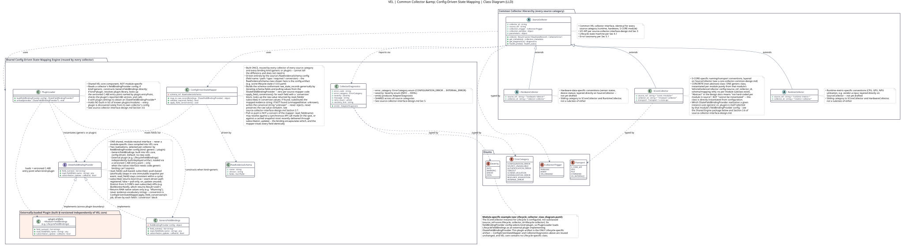
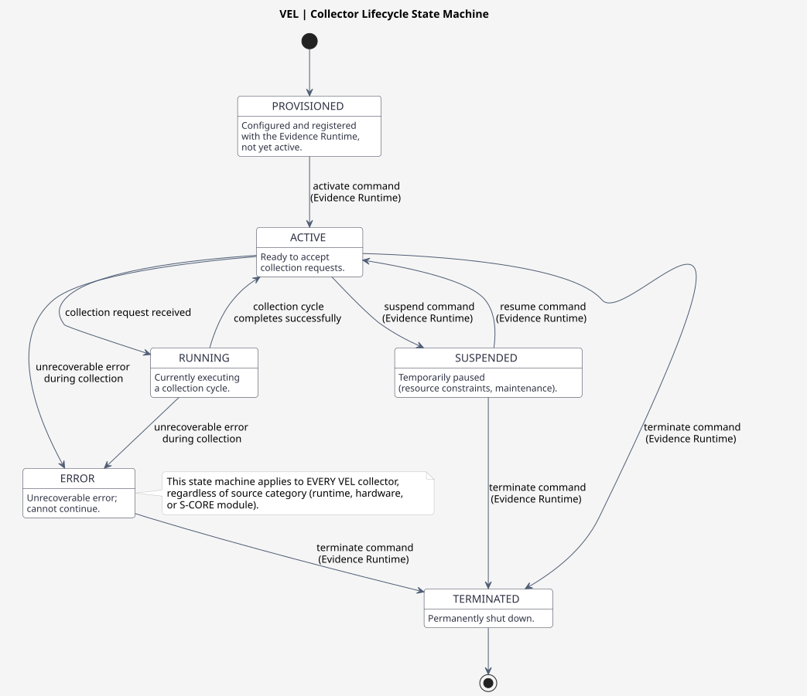

# Source Collector Interface Design

> **See also:** [s-core-state-collection/s-core-collector-common-design.md](s-core-state-collection/s-core-collector-common-design.md) — the S-CORE-specific concrete application of this common interface.

## 1. Purpose

This document defines the **common Source Collector interface**: the collector I/O API, the collector lifecycle within the Evidence Runtime, and collector error/diagnostic reporting. These three aspects are **identical for every VEL collector**, regardless of which source category it reads from:

| Source Category | Example Sources | Collector Design Doc |
| --- | --- | --- |
| Runtime metrics | CPU, GPU, NPU utilization (e.g., vendor-a-npu) | Not yet drafted |
| Hardware data | Sensor states, device status | Not yet drafted |
| S-CORE module state | Lifecycle | [s-core-state-collection/s-core-collector-common-design.md](s-core-state-collection/s-core-collector-common-design.md) |

This document is the collector-interface counterpart to the Input Interface Contract's input-schema-structure document: that contract defines the common **data shape** every source conforms to (`RawEvidenceSchema`); this document defines the common **component behavior** every collector conforms to (I/O contract, lifecycle, diagnostics). Both apply uniformly across runtime, hardware, and S-CORE module sources — neither is S-CORE-specific.

**Serves requirements:** FR-VEL-002 (Accessible Metric Source Mechanism), FR-VEL-003 (S-CORE Module State Collection), FR-VEL-012 (Platform Collector Separation).

## 2. Design Position

- VEL is an **evidence producer**; a collector's responsibility ends at producing a schema-conformant raw state record. Per the [VEL architectural design draft](../../vel_architectural_design_draft_eng.md) (Section 4, Component Responsibilities table): "Source Collectors | Read configured source data and provide source context | Platform-specific implementation; **no normalization policy**." Collectors do not apply the normalization mapping themselves — that is the Normalization Processor's responsibility in Evidence Processing.
- Platform-specific collector implementations (runtime, hardware, S-CORE) remain separate from this common interface (FR-VEL-012): a new source category is added by implementing a new collector against this interface, without changing the interface itself.
- This document is **transport-agnostic**: it does not fix DDS, S-CORE API bindings, files, or commands as the transport. The collector's `source` configuration (transport, api/topic, messageType) is where a concrete collector declares its transport binding.

## 3. Collector I/O API

### 3.1 Purpose

Every VEL collector exposes a **uniform I/O API** so that the Evidence Runtime can interact with it through a single, predictable interface regardless of source category (runtime metric, hardware status, or S-CORE module state).

### 3.2 Input Contract

Every collector accepts the following input parameters:

| Parameter | Type | Required | Description |
|-----------|------|----------|-------------|
| `collector_id` | `string` | Yes | Unique identifier of the collector instance (matches `collector_id` in the collector YAML). |
| `source_ref` | `string` | Yes | Reference to the source being collected (e.g., `score.lifecycle`, `vendor-a.npu`, `hardware.sensor-0`). |
| `collection_trigger` | `enum` | Yes | One of: `periodic`, `event`, `on_demand`. |
| `collection_window` | `object` | No | Optional time window (`start`, `end`) for bounded collection. |
| `parameters` | `object` | No | Source-specific collection parameters (e.g., filter criteria). |

### 3.3 Output Contract

Every collector produces the following output:

| Output | Type | Description |
|--------|------|-------------|
| `raw_state_records` | `array` | Raw state records conforming to the source's `RawEvidenceSchema` (Input Interface Definition) — **not** normalized evidence. Normalization is performed downstream by the Evidence Processing area (Schema Validator, Normalization Processor), which the collector has no policy over. |
| `collection_metadata` | `object` | Metadata about the collection run (timestamp, duration, record count). |
| `diagnostics` | `object` | Diagnostic information (see Section 5). |

### 3.4 I/O Behavior

- **Synchronous** collection: The collector returns raw state records immediately after the source read completes.
- **Asynchronous** collection: The collector returns a `collection_handle` that the Evidence Runtime polls to retrieve raw state records when ready.
- **Idempotency**: Repeated collection with the same `collection_trigger` and `collection_window` produces deterministic results.
- **Timeout**: If the source read exceeds the configured timeout, the collector returns a timeout diagnostic and no raw state records.

### 3.5 Config-Driven State Mapping (common collector internals)

How a collector internally builds its `raw_state_records` (Section 3.3) is itself common infrastructure, not something each source category or module reimplements:

- **`IStateFieldBindingProvider`** — a shared interface (`field_names()` / `read_field(name)` / `subscribe(on_update)`). Each source implements exactly one thin adapter against this interface (e.g. `LifecycleFieldBindings` for the S-CORE Lifecycle module), wrapping that source's native read calls (API, file, command, OS interface). This adapter is the **only** source-specific code in the mapping path. `read_field()` covers synchronous/pull-based sources; `subscribe()` covers event-driven/push-based sources (e.g. Lifecycle's `ext_monitor_notify` callback) — the adapter registers via `subscribe()` and caches the latest value internally, which subsequent `read_field()` calls then return. **Consistency convention for push-based adapters:** on each push event, the adapter builds one immutable snapshot from the full event payload and atomically swaps it in (e.g. `std::atomic<std::shared_ptr<const T>>`), rather than updating per-field mutable state. `ConfigDrivenStateMapper` takes a single snapshot load at the start of each collection cycle, so every `read_field()` call for push-origin fields within one raw record resolves against the same event generation, even if a new push event arrives mid-cycle. This avoids torn records that mix fields from two different events. **Pull-only adapters:** `subscribe()` is part of the interface signature for every adapter, regardless of source category, so the Evidence Runtime and `ConfigDrivenStateMapper` can call it uniformly without per-source conditional logic. An adapter for a purely pull-based source (one with no event-driven/push API) implements `subscribe()` as a no-op: it accepts and stores the `on_update` callback (or simply returns) but never invokes it, since every field it exposes is served directly by `read_field()`. This is not an error or missing capability — it is the expected, valid implementation for a pull-only source.
- **`ConfigDrivenStateMapper`** — built once, shared by every collector regardless of source category. Given a source's `RawEvidenceSchema` config and an `IStateFieldBindingProvider`, it builds the schema-conformant `raw_state_records` generically by iterating the configured fields (name/path/type/required) and pulling each value from the bindings. It contains no per-source logic.

This directly satisfies FR-VEL-012 (Platform Collector Separation) and FR-VEL-013 (Input Interface Configuration) at the collector-implementation level, not only at the schema level: adding a new source requires only a new `RawEvidenceSchema`, a new `EvidenceNormalizationRule`, a collector configuration, and one thin binding adapter — never a new Mapper, Validator, or Normalizer class.



[PlantUML source](../../../features/diagrams/Collector_common_class_diagram.puml)

## 4. Collector Lifecycle

### 4.1 Lifecycle States

Every collector follows the same lifecycle state machine within the Evidence Runtime:



[PlantUML source](../../../features/diagrams/Collector_lifecycle_state_machine.puml)

| State | Description |
|-------|-------------|
| `PROVISIONED` | Collector is configured and registered with the Evidence Runtime but not yet active. |
| `ACTIVE` | Collector is ready to accept collection requests. |
| `RUNNING` | Collector is currently executing a collection cycle. |
| `SUSPENDED` | Collector is temporarily paused (e.g., resource constraints, maintenance). |
| `ERROR` | Collector encountered an unrecoverable error and cannot continue. |
| `TERMINATED` | Collector has been permanently shut down. |

### 4.2 State Transitions

| From | To | Trigger |
|------|----|---------|
| `PROVISIONED` | `ACTIVE` | Evidence Runtime sends `activate` command. |
| `ACTIVE` | `RUNNING` | Collection request received. |
| `RUNNING` | `ACTIVE` | Collection cycle completes successfully. |
| `ACTIVE` | `SUSPENDED` | Evidence Runtime sends `suspend` command. |
| `SUSPENDED` | `ACTIVE` | Evidence Runtime sends `resume` command. |
| `ACTIVE` | `ERROR` | Unrecoverable error during collection. |
| `RUNNING` | `ERROR` | Unrecoverable error during collection. |
| `ERROR` | `TERMINATED` | Evidence Runtime sends `terminate` command. |
| `SUSPENDED` | `TERMINATED` | Evidence Runtime sends `terminate` command. |
| `ACTIVE` | `TERMINATED` | Evidence Runtime sends `terminate` command. |

### 4.3 Health Reporting

Each collector exposes a **health probe** that the Evidence Runtime polls:

```yaml
health_status:
  state: ACTIVE              # Current lifecycle state
  last_collection: "2026-10-01T08:00:00Z"
  collection_count: 42
  error_count: 0
  last_error: null
  uptime_seconds: 86400
```

## 5. Collector Error & Diagnostic Reporting

### 5.1 Error Categories

Every collector uses a common error taxonomy, independent of source category:

| Category | Code | Description | Recoverable |
|----------|------|-------------|-------------|
| `CONFIGURATION_ERROR` | `1001` | Invalid or missing collector configuration. | Yes |
| `SOURCE_UNAVAILABLE` | `1002` | The source (S-CORE API, hardware interface, runtime endpoint) is not reachable or not responding. | Yes |
| `AUTHENTICATION_ERROR` | `1003` | Authentication/authorization failure when accessing the source. | No |
| `TIMEOUT` | `1004` | The source read exceeded the configured timeout. | Yes |
| `SCHEMA_VIOLATION` | `1005` | Collected data does not conform to the expected `RawEvidenceSchema`. | Yes |
| `NORMALIZATION_ERROR` | `1006` | Mapping from raw source state to evidence record failed. | Yes |
| `RESOURCE_EXHAUSTION` | `1007` | Collector ran out of memory, disk, or other resources. | Yes |
| `INTERNAL_ERROR` | `1999` | Unexpected internal error. | No |

### 5.2 Diagnostic Output

The `AdapterDiagnostic` schema is used uniformly by every collector:

```yaml
adapter_diagnostic:
  collector_id: "lifecycle-collector"
  source_ref: "score.lifecycle"
  timestamp: "2026-10-01T08:00:00.123Z"
  severity: ERROR                 # INFO | WARNING | ERROR | FATAL
  error_code: "1002"
  error_category: "SOURCE_UNAVAILABLE"
  message: "S-CORE lifecycle API unreachable"
  retry_count: 3
  recovery_hint: "Check S-CORE lifecycle service availability"
  evidence_record_id: null        # Optional link to affected evidence
```

> **Relationship to the Input Contract's `AdapterDiagnostic`:** This is the same `AdapterDiagnostic` kind referenced by the [Validation Failure Handling contract](../configuration-contracts/input-interface-contract/validation-failure-handling.md), covering a different pipeline stage. This document's shape covers **collector I/O-level** failures (`error_category` values: `CONFIGURATION_ERROR`, `SOURCE_UNAVAILABLE`, `AUTHENTICATION_ERROR`, `TIMEOUT`, `SCHEMA_VIOLATION`, `NORMALIZATION_ERROR`, `RESOURCE_EXHAUSTION`, `INTERNAL_ERROR` -- Section 5.1), which can occur **before** a raw state record even exists to validate (e.g., the source API is unreachable), so fields like `sourceMessageId`/`field` do not apply. The Input Contract's shape covers **schema-validation-level** failures once a record has been read (`failureCategory` values: `missingRequiredField`, `invalidType`, `outOfRange`, `notAllowedValue`, `patternMismatch`, `additionalFieldPresent`). When a collector-level diagnostic has `error_category: SCHEMA_VIOLATION`, the finer-grained `failureCategory` (and the offending `field`) from the Input Contract's `AdapterDiagnostic` are carried in that same diagnostic record to identify which validation rule failed. The two documents describe complementary facets of one `AdapterDiagnostic` kind, not two different schemas.

### 5.3 Failure Handling Integration

- **Transient errors** (e.g., `SOURCE_UNAVAILABLE`, `TIMEOUT`): Collector retries with exponential backoff (up to 3 retries).
- **Permanent errors** (e.g., `AUTHENTICATION_ERROR`, `INTERNAL_ERROR`): Collector transitions to `ERROR` state and notifies the Evidence Runtime.
- **Schema violations**: Collector logs the diagnostic, drops the malformed record, and continues collection.
- **Evidence quality impact**: Any error that prevents evidence collection is reflected in the evidence quality metadata (e.g., `completeness`, `integrity` flags).

### 5.4 Rate Limiting

Collectors implement **diagnostic rate limiting** to prevent log flooding:

- Maximum 10 diagnostics per 60-second window per collector.
- Excess diagnostics are aggregated into a summary diagnostic.
- The Evidence Runtime can configure the rate limit via the collector configuration YAML.

## 6. Common Collector Configuration

Every collector shares this common configuration structure conforming to the `VehicleEvidenceCollector` resource schema (source-specific fields, such as the `transport`/`api` binding, are defined in each source category's own design docs):

```yaml
apiVersion: score.dev/v1alpha1
kind: VehicleEvidenceCollector
metadata:
  name: <source>-collector
  version: 1.0.0
spec:
  source:
    transport: <s-core-api | dds | file | command | os-interface>
    api: "<source-specific-api-or-topic>"
    messageType: <MessageType>
  inputSchemaRef:
    name: <input-schema-name>
    version: 1.0.0
    path: schemas/<input-schema>.yaml
  normalizationRuleRef:
    name: <mapping-rule-name>
    version: 1.0.0
    path: mappings/<normalization-mapping>.yaml
  outputSchemaRef:
    name: score-normalized-evidence
    version: 1.0.0
    path: ../vel-output-evidence-package/schemas/score-normalized-evidence-v1.0.0.yaml
  publication:
    transport: dds
    topic: ScoreNormalizedEvidence
    deliveryClass: reliable
  velHealth:
    topic: ScoreEvidenceLayerHealth
    heartbeatPeriod: 1s
  resourceLimits:
    inputQueueDepth: 256
    maximumMessageRate: 1000
```

## 7. Relationship to Source-Category Design Docs

| Aspect | Document |
|--------|----------|
| Collector I/O API | **This document** (common, all source categories) |
| Collector lifecycle | **This document** (common, all source categories) |
| Error & diagnostic reporting | **This document** (common, all source categories) |
| Config-driven state mapping (`IStateFieldBindingProvider`, `ConfigDrivenStateMapper`) | **This document, Section 3.5** (common, all source categories) |
| S-CORE module collector conventions | [s-core-state-collection/s-core-collector-common-design.md](s-core-state-collection/s-core-collector-common-design.md) |
| S-CORE module API surface / state fields / transport path | [s-core-state-collection/collectors/lifecycle-collector-design.md](s-core-state-collection/collectors/lifecycle-collector-design.md) (per module) |
| Runtime and hardware collector conventions | Not yet drafted |

## 8. Traceability

| Item | Reference |
| --- | --- |
| Design | Source Collector Interface Design |
| Requirements | FR-VEL-002, FR-VEL-003, FR-VEL-012 |
| Concrete applications | S-CORE State Collection (drafted), Runtime and Hardware Collection (not yet drafted) |
| Reference architecture | [`vel_architectural_design_draft_eng.md`](../../vel_architectural_design_draft_eng.md) |
