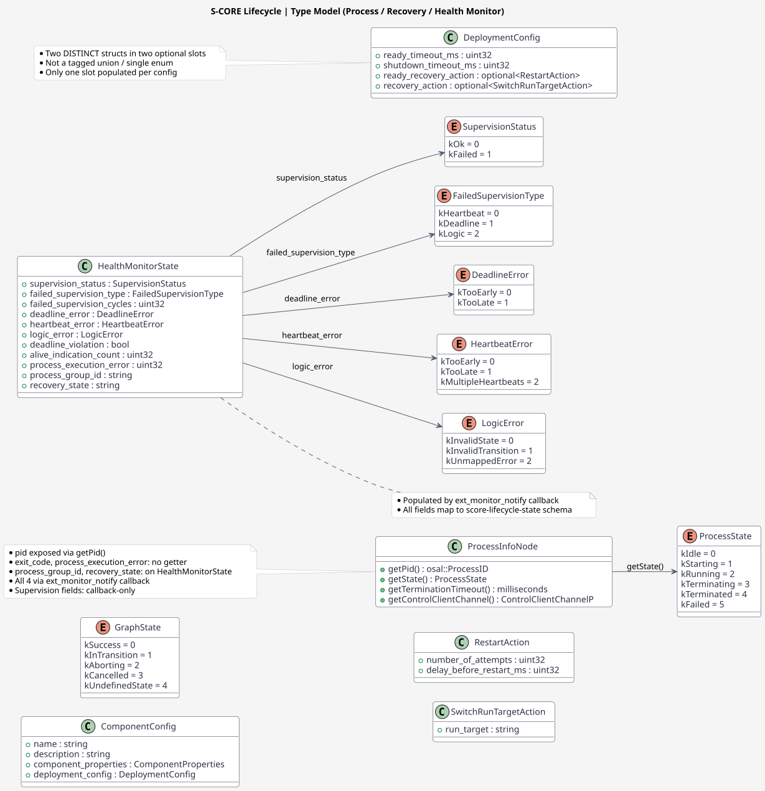
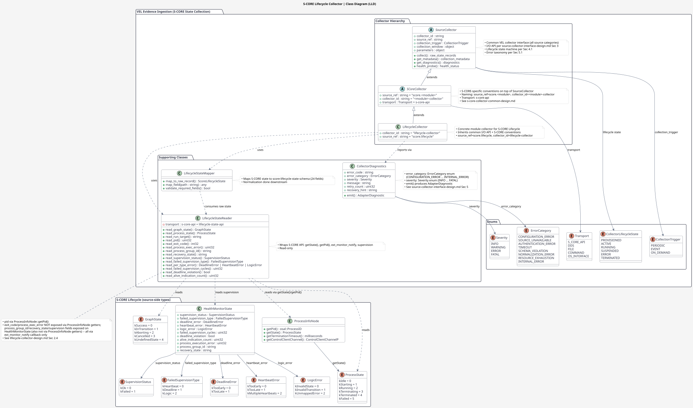
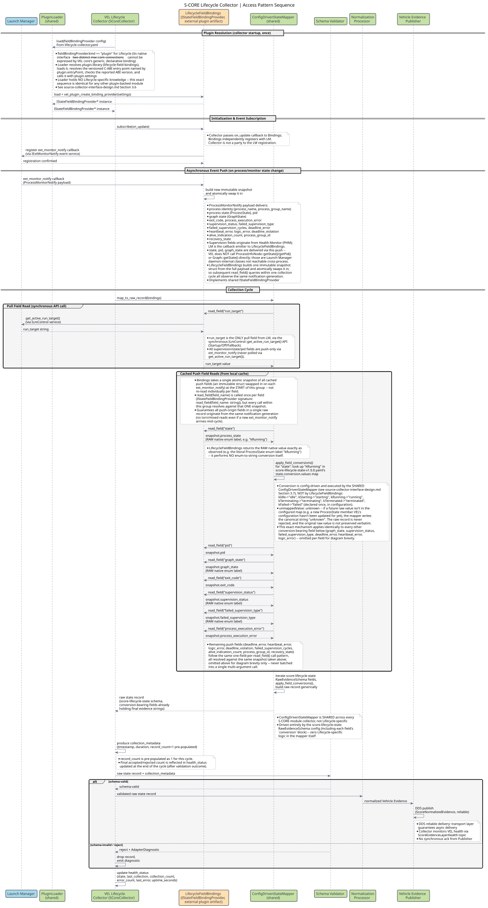
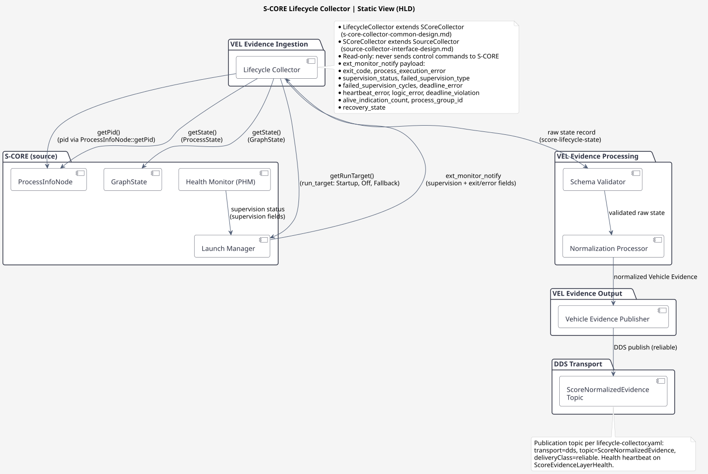
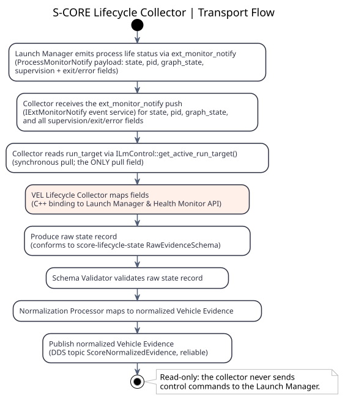

# Lifecycle 수집기 설계

## 개요

이 문서는 S-CORE Lifecycle 수집기의 **모듈별** 설계를 정의합니다. Lifecycle 모듈에 특정한 API 표면, 관찰 가능한 상태 필드, 소스 식별, 전송 경로를 다룹니다.

> **공통 측면** (수집기 I/O API, 라이프사이클, 오류 및 진단 보고)은 공유 문서에서 정의됩니다: [`../../source-collector-interface-design.md`](../../source-collector-interface-design.md) (모든 VEL 수집기에 공통) 및 [`../s-core-collector-common-design.md`](../s-core-collector-common-design.md) (S-CORE 특화 명명 관례).

---

## 1. 수집기 구성

참조: `lifecycle-collector.yaml` (`interfaces/score-evidence-layer-package/collectors/lifecycle-collector.yaml`)

```yaml
apiVersion: score.dev/v1alpha1
kind: VehicleEvidenceCollector
metadata:
  name: lifecycle-collector
  version: 1.0.0
spec:
  source:
    transport: s-core-api
    api: lifecycle-state-api
    messageType: ScoreLifecycleState
  fieldBindingProvider:
    # kind: plugin -- Lifecycle의 네이티브 인터페이스(두 개의 서로 다른 mw::com
    # 서비스 연결: ILmControl 풀 + IExtMonitorNotify 푸시)는 VEL 코어의 제네릭,
    # 선언적 바인딩으로 표현할 수 없으므로, 해당 IStateFieldBindingProvider
    # 실현은 독립적으로 빌드/배포된 플러그인이며, 공유 PluginLoader가 이 구성에서만
    # 로드합니다 (참조: source-collector-interface-design.md Section 3.6). 이것이
    # 이 선택이 이루어지는 유일한 곳입니다 -- VEL 코어에는 Lifecycle 특화 수집기
    # 하위 클래스나 하드코딩된 팩토리 항목이 없습니다.
    kind: plugin
    plugin:
      library: plugins/lifecycle-field-bindings
      abiVersion: 1
      entryPoint: vel_plugin_create_binding_provider
      settings:
        transport: s-core-api
        api: lifecycle-state-api
  inputSchemaRef:
    name: score-lifecycle-state
    version: 1.0.0
    path: schemas/score-lifecycle-state-v1.0.0.yaml
  normalizationRuleRef:
    name: score-lifecycle-to-evidence
    version: 1.0.0
    path: mappings/score-lifecycle-to-evidence-v1.0.0.yaml
  outputSchemaRef:
    name: score-normalized-evidence
    version: 1.0.0
    path: ../vel-output-evidence-package/schemas/score-normalized-evidence-v1.0.0.yaml
  publication:
    transport: dds
    topic: ScoreNormalizedEvidence
    deliveryClass: reliable
  velHealth:
    topic: ScoreEvidenceLayerHealth
    heartbeatPeriod: 1s
  resourceLimits:
    inputQueueDepth: 256
    maximumMessageRate: 1000
```

모듈 상태 필드에 대한 필드 수준 바인딩 및 변환은 `schemas/score-lifecycle-state-v1.0.0.yaml`에 선언됩니다(여기에 중복하지 않음). 예를 들어, `state`의 선언은 다음과 같습니다:

```yaml
- name: state
  path: $.state
  type: string
  required: true
  conversion:
    operation: enumMap
    sourceValueKind: enum
    values: {kIdle: idle, kStarting: starting, kRunning: running, kTerminating: terminating, kTerminated: terminated, kFailed: failed}
    unmappedValue: unknown
```

`LifecycleFieldBindings.read_field("state")`는 소스에서 관찰된 raw 네이티브 라벨(예: `"kRunning"`)을 반환합니다; 공유 `ConfigDrivenStateMapper`가 그 값을 `conversion.values`에서 조회하여 `"running"`을 raw 레코드에 기록합니다. 향후 S-CORE 릴리스가 VEL 구성이 아직 갱신되지 않은 `ProcessState` 멤버를 추가하면(예: 가상의 `kDegraded`), `unmappedValue: unknown`은 매퍼가 표준 문자열 `"unknown"`을 evidence 문자열로 기록함을 의미합니다 — 레코드를 거부하거나 raw 라벨을 그대로 보존하지 않습니다. 전체 메커니즘은 [source-collector-interface-design.md Section 3.7](../../source-collector-interface-design.md#37-필드-값-변환-공통-수집기-내부-구조)을 참조하십시오. 이는 모든 S-CORE 모듈이 공유하며 Lifecycle 특화가 아닙니다.

---

## 2. S-CORE API 표면

**컴포넌트:** Launch Manager, Health Monitor (PHM - Platform Health Management).

### 2.1 관찰 가능한 상태

- **실행 대상 상태**: 활성 실행 대상 (문자열 이름, 예: `"Startup"`, `"Off"`, `"Fallback"`).
- **컴포넌트 상태**: 시작됨, 실행 중, 중지됨 (Lifecycle 인터페이스 기준).
- **프로세스 상태**: 활성/생존, 종료 코드, 리소스 사용량.
- **프로세스 런타임 식별자**: 프로세스 식별자 (`pid`), 외부 모니터 알림 기능을 통해 전달되며 (섹션 2.4 참조) 스키마에서 `details.pid`로 표시됩니다.
- **준비 조건**: 컴포넌트가 준비 상태에 도달했는지 여부 (프로세스 상태 전환에서 유추).
- **Health Monitor 상태**: 데드라인 모니터, 로직 모니터, 하트비트 모니터 상태. 감독 상태 (ok/failed, 유형별 오류 존재 여부에서 파생), 실패한 감독 유형 (heartbeat/deadline/logic), 특정 유형별 오류 (deadline_error, heartbeat_error, logic_error), 데드라인 위반, 실패한 감독 주기, 활성 표시 횟수, 프로세스 실행 오류, 프로세스 그룹 식별자, 복구 상태를 포함합니다.

### 2.2 데이터 정의 (호출 가능한 API가 아닌 유형)

- **`ProcessState` 열거형** (`lifecycle/score/launch_manager/src/daemon/src/process_group_manager/process_state.hpp`):
  ```cpp
  enum class ProcessState : std::uint8_t {
      kIdle = 0,         // process in idle state.
      kStarting = 1,     // process in starting state.
      kRunning = 2,      // process in running state.
      kTerminating = 3,  // process in terminating state.
      kTerminated = 4,   // process in terminated state.
      kFailed = 5        // process failed to start.
  };
  ```

- **`GraphState` 열거형** (`lifecycle/score/launch_manager/src/daemon/src/process_group_manager/details/graph.hpp`):
  ```cpp
  enum class GraphState : std::uint8_t {
      kSuccess = 0U,        // Graph is not running and process group state is known
      kInTransition = 1U,   // Graph is running, process group state is in transition
      kAborting = 2U,       // Graph is running but has been aborted due to error
      kCancelled = 3U,      // Graph is running but has been cancelled because a new transition is pending
      kUndefinedState = 4U  // Graph is not running but process group state is not known
  };
  ```

아래 다이어그램은 `ProcessState`, `GraphState`, 복구 작업 구성 유형, Health Monitor 감독 유형을 유형 모델로 보여줍니다. `RestartAction`과 `SwitchRunTargetAction`은 **별개의** 구성 구조체로, **서로 다른** 선택적 슬롯 (`ready_recovery_action` / `recovery_action`)을 차지합니다 — 태그된 유니온이나 단일 열거형이 아닙니다.



[PlantUML 소스](../../../../../features/diagrams/lifecycle/Lifecycle_type_model.puml)

아래 클래스 다이어그램은 VEL 측 수집기 구현 클래스를 보여줍니다. `SCoreCollector`(S-CORE 특정 규칙, 추상 `SourceCollector` 확장)는 `lifecycle-collector.yaml`에서 `source_ref=score.lifecycle`, `collector_id=lifecycle-collector`로 **직접 인스턴스화**됩니다. 매핑/검증/진단 엔진 (`ConfigDrivenStateMapper`, `CollectorDiagnostics`)은 **모든 S-CORE 모듈 수집기에서 공유**되며 Lifecycle 특화가 아닙니다. Lifecycle의 `IStateFieldBindingProvider` 실현(`LifecycleFieldBindings`)은 공유 `PluginLoader`가 **독립적으로 빌드/배포된 플러그인**(바인딩 아티팩트, `lifecycle-collector.yaml`의 `fieldBindingProvider` 구성에서만 선택됨)으로 런타임에 로드합니다. 그 이유는 Lifecycle의 네이티브 인터페이스 — 두 개의 서로 다른 `mw::com` 서비스 연결 — 가 VEL 코어의 제네릭, 선언적 바인딩으로 표현될 수 없기 때문입니다. `LifecycleFieldBindings`는 전체 설계에서 유일한 Lifecycle 특화 아티팩트이며, VEL 코어에 절대 컴파일되지 않습니다. 향후 모듈을 설정 기반으로 유지하는 방법에 대해서는 Section 7을, 이 실현이 의존하는 공유 플러그인 로딩 및 필드 변환 메커니즘에 대해서는 `source-collector-interface-design.md` Sections 3.5-3.7을 참조하십시오.



[PlantUML 소스](../../../../../features/diagrams/lifecycle/Lifecycle_collector_class_diagram.puml)

### 2.3 Lifecycle API 필드

- **`run_target`** — 동기식 `ILmControl::get_active_run_target()` API (`lm_control/src/ilm_control.hpp`)를 통해 노출되며, Launch Manager에게 현재 결정된 Run Target의 이름을 조회합니다. 이는 **유일한 풀/동기** 필드이며, 아래의 다른 모든 필드는 푸시 기반입니다.
- **`state`, `pid`, `graph_state`, `exit_code`, `process_execution_error`** — 외부 모니터 알림 기능(`comp_req__launch_man__ext_monitor_notify` 요구사항)의 `ProcessMonitorNotify` 페이로드 일부로 전달됩니다. 이들 필드에 대한 별도의 풀 API는 없습니다. 이 상태를 내부적으로 보유하는 `ProcessInfoNode`와 `Graph`는 외부 VEL 프로세스에서 접근할 수 없는 Launch Manager 데몬 내부 클래스입니다.
- **활성 보고** — Health Monitor는 Alive API (`report_alive()` / `report_failure()`)를 통해 Launch Manager에 생존을 보고합니다. 참고: 이는 **쓰기** 경로입니다 (감독되는 프로세스가 자체적으로 보고). VEL은 이를 사용하여 다른 프로세스의 상태를 읽을 수 없습니다.
- **Health Monitor 감독 유형** — Health Monitor는 세 가지 감독 유형 (데드라인, 하트비트, 로직)을 평가하며, 각각 고유한 오류 열거형과 상태 스냅샷을 가지며 동일한 외부 모니터 알림 기능을 통해 전달됩니다.

### 2.4 수집기 접근 패턴

```cpp
#include "score/mw/lifecycle/ilm_control.hpp"
#include "score/mw/lifecycle/ext_monitor/ext_monitor_notify.hpp"

// 1. run_target은 공개 ILmControl API를 통해 동기적으로 읽는 유일한 필드입니다.
score::Result<score::mw::lifecycle::RunTargetName> run_target = lm_control->get_active_run_target();

// 2. 그 외 모든 필드(state, pid, graph_state, exit_code, process_execution_error,
//    process_group_id, recovery_state 및 모든 Health Monitor 감독 필드)는
//    외부 모니터 알림 기능(comp_req__launch_man__ext_monitor_notify)을 통해
//    ProcessMonitorNotify 페이로드로 전달됩니다. LifecycleFieldBindings는 공유
//    IStateFieldBindingProvider의 subscribe(on_update) 메서드(푸시 기반)로 이를
//    등록하며, 이는 read_field()(풀 기반)로 읽는 run_target과 대조됩니다. 외부
//    VEL 프로세스에서 접근 가능한 타입 위에는 이들 필드에 대한 동기 getter가
//    존재하지 않습니다 — 이 상태를 내부적으로 보유하는 ProcessInfoNode와 Graph는
//    Launch Manager 데몬 내부 클래스입니다.
//
//    read_field()/subscribe()는 관찰된 그대로의 RAW 네이티브 값(예: 리터럴
//    ProcessState enum 라벨 "kRunning")을 반환합니다 -- LifecycleFieldBindings는
//    자체적으로 enum-to-string 변환을 수행하지 않습니다. 해당 변환은 공유
//    ConfigDrivenStateMapper가 각 필드의 score-lifecycle-state-v1.0.0.yaml에 있는
//    `conversion` 블록(섹션 2.2의 구성 예시 및 섹션 4 참조)에 의해 구동되어
//    일반적으로 적용되며, 인식되지 않은 raw 값은 거부되거나 고정 센티널로 다시
//    쓰여지지 않고 그대로 보존됩니다. 이는 LifecycleFieldBindings를 얇고 소스 전용
//    플러그인으로 유지합니다.
//
//    일관성 보장: 각 알림마다 LifecycleFieldBindings는 전체 페이로드로부터 하나의
//    불변(immutable) 스냅샷 구조체를 생성하고 그에 대한 참조를 원자적으로
//    교체합니다. 이는 필드 단위의 가변 상태를 갱신하는 대신 적용됩니다.
//    ConfigDrivenStateMapper는 푸시 기반 필드를 순회하기 전, 수집 주기마다
//    해당 스냅샷을 단 한 번만 가져오므로, 하나의 raw 레코드 내에서 푸시 기반
//    필드에 대한 모든 read_field() 호출은 동일한 알림 세대(notification generation)를
//    참조하게 됩니다 — 수집 주기 도중 새로운 알림이 도착하더라도 마찬가지입니다.
//    이를 통해 예를 들어 supervision_status는 한 장애 이벤트를,
//    failed_supervision_type은 그보다 나중의 다른 이벤트를 반영하는 식의
//    불일치(torn) 레코드를 방지합니다. 이는 LifecycleFieldBindings의 내부 구현
//    세부사항이며, 스키마나 매퍼 변경이 필요하지 않습니다.

// 3. LifecycleFieldBindings는 공유 IStateFieldBindingProvider 인터페이스(field_names() /
//    read_field() / subscribe())를 통해 이러한 값을 노출합니다. 이후 공유 ConfigDrivenStateMapper(Lifecycle
//    특화가 아님)가 score-lifecycle-state RawEvidenceSchema를 순회하며 각 필드 값을 바인딩에서
//    가져와 raw 상태 레코드를 일반적으로 구성합니다.
```

아래 시퀀스는 `get_active_run_target()` 읽기 경로와 푸시 기반 필드에 대한 외부 모니터 알림 콜백 경로를 포함한 전체 접근 패턴 상호작용을 보여줍니다:



[PlantUML 소스](../../../../../features/diagrams/lifecycle/Lifecycle_collector_sequence.puml)

---

## 3. 소스 식별

| 필드 | 값 |
|-------|-------|
| `source_id` | `score-lifecycle` |
| `workload_id` | `launch-manager` 또는 `health-monitor` |
| `resource_id` | `component:<이름>` 또는 `run-target:<이름>` 또는 `monitor:<유형>` |

---

## 4. 상태 필드 (원시 Evidence 스키마)

수집기는 `score-lifecycle-state` 스키마 (`interfaces/score-evidence-layer-package/schemas/score-lifecycle-state-v1.0.0.yaml`)를 준수하는 원시 상태 레코드를 생성합니다:

| 필드 | 경로 | 유형 | 필수 | 변환 |
|-------|------|------|----------|------------|
| `message_id` | `$.message_id` | string | ✓ | – |
| `source_id` | `$.source_id` | string | ✓ | – |
| `workload_id` | `$.workload_id` | string | ✓ | – |
| `execution_id` | `$.execution_id` | string | ✓ | – |
| `resource_id` | `$.resource_id` | string | ✓ | – |
| `timestamp_ns` | `$.timestamp_ns` | uint64 | ✓ | – |
| `state` | `$.state` | string | ✓ | `enumMap`, `unmappedValue: unknown` |
| `previous_state` | `$.previous_state` | string | – | `enumMap`, `unmappedValue: unknown` |
| `transition_time_ns` | `$.transition_time_ns` | uint64 | – | – |
| `run_target` | `$.details.run_target` | string | – | – |
| `exit_code` | `$.details.exit_code` | int32 | – | – |
| `pid` | `$.details.pid` | uint32 | – | – |
| `graph_state` | `$.details.graph_state` | string | – | `enumMap`, `unmappedValue: unknown` |
| `supervision_status` | `$.details.supervision_status` | string | – | `enumMap`, `unmappedValue: unknown` |
| `failed_supervision_cycles` | `$.details.failed_supervision_cycles` | uint32 | – | – |
| `failed_supervision_type` | `$.details.failed_supervision_type` | string | – | `enumMap`, `unmappedValue: unknown` |
| `deadline_error` | `$.details.deadline_error` | string | – | `enumMap`, `unmappedValue: unknown` |
| `heartbeat_error` | `$.details.heartbeat_error` | string | – | `enumMap`, `unmappedValue: unknown` |
| `logic_error` | `$.details.logic_error` | string | – | `enumMap`, `unmappedValue: unknown` |
| `deadline_violation` | `$.details.deadline_violation` | bool | – | – |
| `alive_indication_count` | `$.details.alive_indication_count` | uint32 | – | – |
| `process_execution_error` | `$.details.process_execution_error` | uint32 | – | – |
| `process_group_id` | `$.details.process_group_id` | string | – | – |
| `recovery_state` | `$.details.recovery_state` | string | – | – |

> **왜 `string`이지 `enum`이 아닌가:** 이 필드들은 S-CORE Lifecycle 모듈 자체의 enum(`ProcessState`, `GraphState`, `SupervisionStatus`, `FailedSupervisionType`, `DeadlineError`, `HeartbeatError`, `LogicError`)에서 비롯된 인터페이스별 상태/오류 값을 전달합니다. VEL은 이러한 값 집합을 폐쇄된 스키마 제약(`allowedValues`)으로 소유하거나 열거하지 않습니다 — 향후 S-CORE 릴리스가 그 중 하나에 새 멤버를 추가할 수 있기 때문입니다. 대신 각 필드의 `conversion` 블록(섹션 2.2의 구성 예시에 표시된 대로 `schemas/score-lifecycle-state-v1.0.0.yaml`에 한 번 선언됨)이 **현재 알려진** raw 네이티브 라벨을 evidence 문자열 형태로 매핑하고, `unmappedValue: unknown`은 인식되지 않은 raw 값이 표준 문자열 `"unknown"`으로 표시됨을 보장합니다 — 거부되지 않으며, 그대로 보존되지 않습니다. 이를 실행하는 공유 메커니즘에 대해서는 [source-collector-interface-design.md Section 3.7](../../source-collector-interface-design.md#37-필드-값-변환-공통-수집기-내부-구조)을 참조하십시오.

---

## 5. 전송 경로

아래 정적 뷰는 VEL Evidence Ingestion 아키텍처에서 Lifecycle 수집기의 위치와 Schema Validator, Normalization Processor, DDS 게시 토픽과의 상호작용을 보여줍니다:



[PlantUML 소스](../../../../../features/diagrams/lifecycle/Lifecycle_collector_static_view.puml)



[PlantUML 소스](../../../../../features/diagrams/lifecycle/Lifecycle_collector_transport_flow.puml)

---

## 6. S-CORE API 경계

VEL은 S-CORE가 **안정적이고 공개된 외부 API**를 통해 노출하는 데이터만 수집할 수 있습니다. Lifecycle 모듈의 경우:

- **허용**: `ILmControl::get_active_run_target()`를 통해 `run_target`, 외부 모니터 알림 기능을 통해 `state`, `pid`, `ProcessState`, `GraphState`, `exit_code`, `process_execution_error`, `process_group_id`, `recovery_state`, Health Monitor 감독 상태 (supervision_status, failed_supervision_type, deadline_error, heartbeat_error, logic_error, deadline_violation, failed_supervision_cycles, alive_indication_count) 읽기.
- **허용되지 않음**: 제어 명령 전송 (프로세스 시작/중지/재시작), `report_alive()` / `report_failure()` 호출 (쓰기 경로), 또는 모든 라이프사이클/프로세스/하드웨어 제어 작업.

이는 `saf_req__vel__*` (라이프사이클/프로세스/컨테이너/하드웨어 제어 없음, 조정 없음, OEM 결정 없음)를 충족합니다.

---

## 7. 확장성: 새로운 S-CORE 모듈 추가

Section 2.2에 표시된 매핑/검증 엔진은 **공유 인프라**이며 Lifecycle 특화가 아니며, 새로운 S-CORE 모듈 수집기를 추가한다고 해서 VEL 코어에 새 모듈별 클래스를 추가한다는 뜻은 **아닙니다**. 다음을 의미합니다:

1. 인터페이스별 상태/오류 필드에 `conversion` 블록이 있는 새로운 `RawEvidenceSchema` 구성 (`schemas/score-<module>-state-v1.0.0.yaml`) — 그러한 필드에 폐쇄된 `enum`/`allowedValues`는 절대 아닙니다 (Section 4 및 `source-collector-interface-design.md` Section 3.7).
2. 새로운 `EvidenceNormalizationRule` 구성 (`mappings/score-<module>-to-evidence-v1.0.0.yaml`).
3. 모듈의 `IStateFieldBindingProvider`가 어떻게 실현되는지 선택하는 `fieldBindingProvider` 블록을 포함한 새로운 `VehicleEvidenceCollector` 구성 (`collectors/<module>-collector.yaml`):
   - **`kind: generic`** (기본값, 선호 경로) -- 모듈의 상태가 VEL 코어의 내장, 설정 기반 제네릭 바인딩을 통해 도달 가능합니다(기존 전송/공급자 기능을 구성에서만 선언적으로 재사용). **이 경우 새 코드가 전혀 필요 없습니다.**
   - **`kind: plugin`** -- 제네릭 바인딩이 모듈의 네이티브 인터페이스를 실제로 표현할 수 없을 때에만 (Lifecycle의 경우처럼, 상태가 소스별 페이로드 디코딩이 있는 두 개의 서로 다른 네이티브 `mw::com` 서비스 연결을 요구할 때). 이 경우 모듈의 `IStateFieldBindingProvider` 실현을 VEL 코어와 별도로 버전 관리되는 자체 **독립적으로 빌드/배포된 바인딩 아티팩트**로 구현하고, 수집기 구성의 `fieldBindingProvider.plugin` 블록이 그것을 가리키게 합니다. 공유 `PluginLoader`(`source-collector-interface-design.md` Section 3.6)가 **그 구성에서만** 이를 검색하고 로드합니다 — 어떤 시점에도 VEL 코어 소스가 수정되거나, 수집기 하위 클래스가 추가되거나, 하드코딩된 팩토리/등록 목록이 갱신되거나, VEL 코어가 다시 빌드되지 않습니다.

모듈별로 새로운 Mapper, Validator, Normalizer 클래스나 `SCoreCollector` 하위 클래스는 절대 작성되지 않습니다 — `SCoreCollector` 자체는 하나의 제네릭 클래스이며, `VehicleEvidenceCollector` 구성에서만 모듈별로 인스턴스화되고, `ConfigDrivenStateMapper`, Schema Validator, Normalization Processor는 한 번만 구축되어 해당 모듈이 사용하는 바인딩 종류와 무관하게 모든 S-CORE 모듈 수집기가 재사용합니다.

**Lifecycle 자체의 실현은 `kind: plugin` 사례입니다**, 기본값이 아닙니다: 해당 `LifecycleFieldBindings` 플러그인은 네이티브 이중 연결 인터페이스(Section 2.4) 때문에 특별히 필요하며, 이 전체 설계에서 유일한 Lifecycle 특화 아티팩트입니다 — `lifecycle-collector.yaml`의 `fieldBindingProvider` 블록(Section 1)에 설명된 대로 VEL 코어와 독립적으로 빌드/배포됩니다.

## 8. 추적성

| 항목 | 참조 |
|------|-----------|
| 설계 | Lifecycle 수집기 설계 |
| 요구사항 | FR-VEL-003, AOU-VEL-002 |
| 수집기 구성 | `lifecycle-collector.yaml` (`interfaces/score-evidence-layer-package/collectors/lifecycle-collector.yaml`) |
| 입력 스키마 | `score-lifecycle-state-v1.0.0.yaml` (`interfaces/score-evidence-layer-package/schemas/score-lifecycle-state-v1.0.0.yaml`) |
| 정규화 매핑 | `score-lifecycle-to-evidence-v1.0.0.yaml` (`interfaces/score-evidence-layer-package/mappings/score-lifecycle-to-evidence-v1.0.0.yaml`) |
